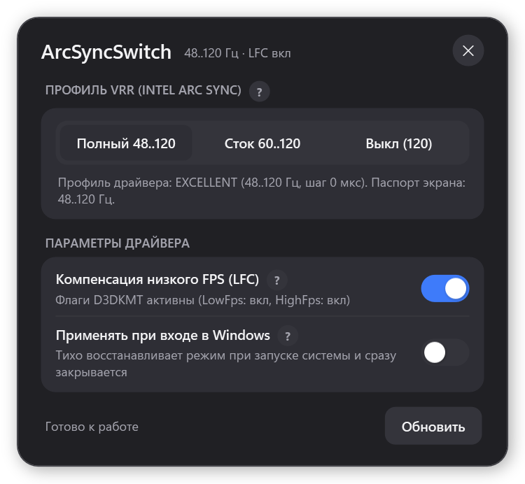

# ArcSyncSwitch

[Русская версия](README_RU.md)

Compact Intel Arc Sync (VRR) and LFC profile switcher for Windows 11 handhelds (tested on MSI Claw 8 AI+). Switches hidden Intel driver profiles directly via `ControlLib.dll` and `D3DKMT` without modifying panel EDID data, keeping custom resolutions such as `1600x1000` and `1536x960` intact.



## What It Controls

- **Intel Arc Sync Profile (`ControlLib.dll`)**:
  - **Full 48..120 (`EXCELLENT`)**: unlocks the full hardware panel VRR range (`48..120 Hz`) instead of Intel's default `60..120 Hz` (`COMPATIBLE`) clamp.
  - **Stock 60..120 (`COMPATIBLE`)**: restores Intel's default profile.
  - **Off (`OFF`)**: disables VRR (fixed `120 Hz`).
- **Low Framerate Compensation (`LFC`)**: toggles Intel driver `LowFpsSolutionEnabled` and `HighFpsSolutionEnabled` flags via `D3DKMT` private escape.
- **Logon Autostart (`--apply`)**: creates a per-user Windows Task Scheduler logon entry (`ArcSyncSwitch`, works without UAC and under Xbox Full Screen Experience) that restores the saved profile at sign-in and exits immediately with zero background memory or CPU usage.
- **Touch-friendly Help Tips (`?`)**: tap `?` next to each section/toggle for a detailed explanation, including compatibility notes for ClawTweaks.

## Installation

Download `ArcSyncSwitch-Setup-1.0.0.0.exe` from [Releases](https://github.com/carbonumbrella/arcsync-switch/releases).

- Per-user install into `%LOCALAPPDATA%\Programs\ArcSyncSwitch` (no administrator rights required).
- Automatically checks for `.NET 10 Desktop Runtime` and installs it if missing.
- Includes full Windows Apps & Features uninstaller (`unins000.exe`) that stops the app, deletes the logon task, and removes config files.

## CLI Options

- `--apply`: silently applies the saved configuration (`%APPDATA%\ArcSyncSwitch\config.json`) with retry on startup.
- `--set-autostart on|off`: registers or removes the logon task.
- `--quit`: closes an active UI instance cleanly.
- `--render <path.png> [--light|--dark]`: renders an off-screen UI screenshot.

## Build from Source

Requires the `.NET 10 SDK` and optionally `Inno Setup 6`:

```cmd
build.cmd
```

## License

MIT. See [LICENSE](LICENSE).
