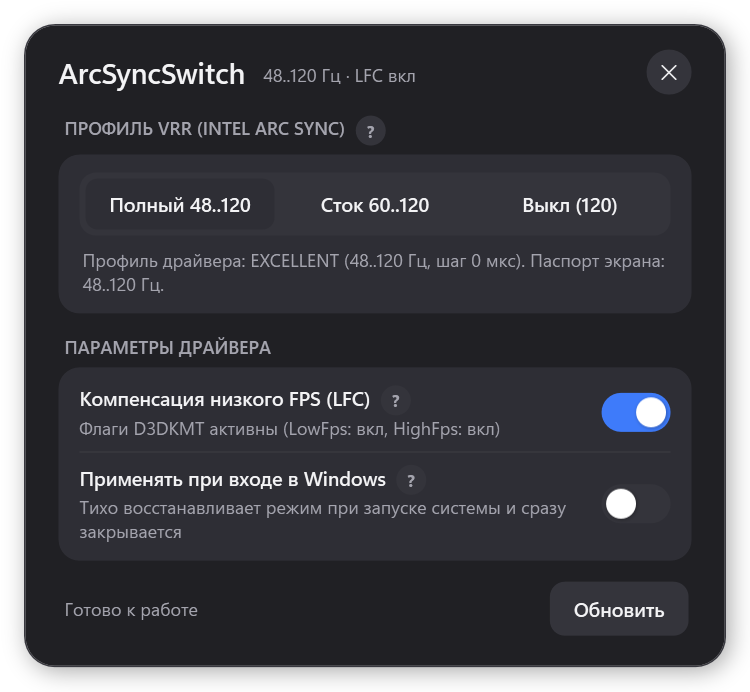

# ArcSyncSwitch

[English version](README.md)

Компактный переключатель профилей Intel Arc Sync (VRR) и компенсации низкого FPS (LFC) для портативных ПК на Windows 11 (проверено на MSI Claw 8 AI+). Работает напрямую через системную библиотеку `ControlLib.dll` и интерфейс `D3DKMT`, не изменяет EDID экрана и сохраняет кастомные разрешения (`1600x1000`, `1536x960`).



## Возможности

- **Выбор профиля VRR (`ControlLib.dll`)**:
  - **Полный 48..120 (`EXCELLENT`)**: снимает программный зажим драйвера `60..120 Гц` (`COMPATIBLE`) и открывает полный аппаратный диапазон матрицы `48..120 Гц`.
  - **Сток 60..120 (`COMPATIBLE`)**: возвращает заводской профиль Intel по умолчанию.
  - **Выкл (`OFF`)**: отключает переменное обновление (фиксированные `120 Гц`).
- **Отдельный тумблер LFC**: управляет внутренними флагами драйвера `LowFpsSolutionEnabled` и `HighFpsSolutionEnabled` через прямой вызов `D3DKMT`.
- **Автозапуск при входе (`--apply`)**: создаёт пользовательскую задачу планировщика `ArcSyncSwitch` (без запроса UAC, работает в том числе в полноэкранной оболочке Xbox), которая при входе в Windows тихо восстанавливает выбранный режим и сразу завершается с нулевой нагрузкой в фоне.
- **Сенсорные подсказки (`?`)**: рядом с каждым блоком есть кнопка `?`, раскрывающая подробное описание параметров и предупреждение о совместимости с тумблером VRR в ClawTweaks.

## Важное предупреждение об оверлеях производительности

Некоторые оверлеи производительности (счётчики FPS и телеметрия поверх окна игры) способны ломать плавность картинки в районе 60 FPS даже при активном профиле `48..120 Гц`:

- Окно оверлея поверх игры (особенно в безрамочном режиме) может нарушать прямой вывод кадра (`Independent Flip` / `MPO`), из-за чего композитор Windows привязывает обновление к частоте перерисовки самого оверлея (часто к 60 Гц), а периодический опрос датчиков добавляет микроскачки времени кадра.
- Если в игре около 60 FPS наблюдаются подёргивания, сначала полностью отключите оверлей производительности и проверьте плавность без него, прежде чем менять профиль VRR или отключать LFC.

## Установка

Скачайте `ArcSyncSwitch-Setup-1.0.0.0.exe` со страницы [Releases](https://github.com/carbonumbrella/arcsync-switch/releases).

- Установка в `%LOCALAPPDATA%\Programs\ArcSyncSwitch` без прав администратора.
- Проверка наличия `.NET 10 Desktop Runtime` (при отсутствии скачивает официальный установщик Microsoft).
- Полноценное удаление через «Установленные приложения» Windows (закрывает окно, удаляет задачу планировщика, конфигурацию и файлы программы).

## Сборка из исходников

Требуется `.NET 10 SDK` и (опционально) `Inno Setup 6`:

```cmd
build.cmd
```

## Лицензия

MIT. Подробнее в файле [LICENSE](LICENSE).
